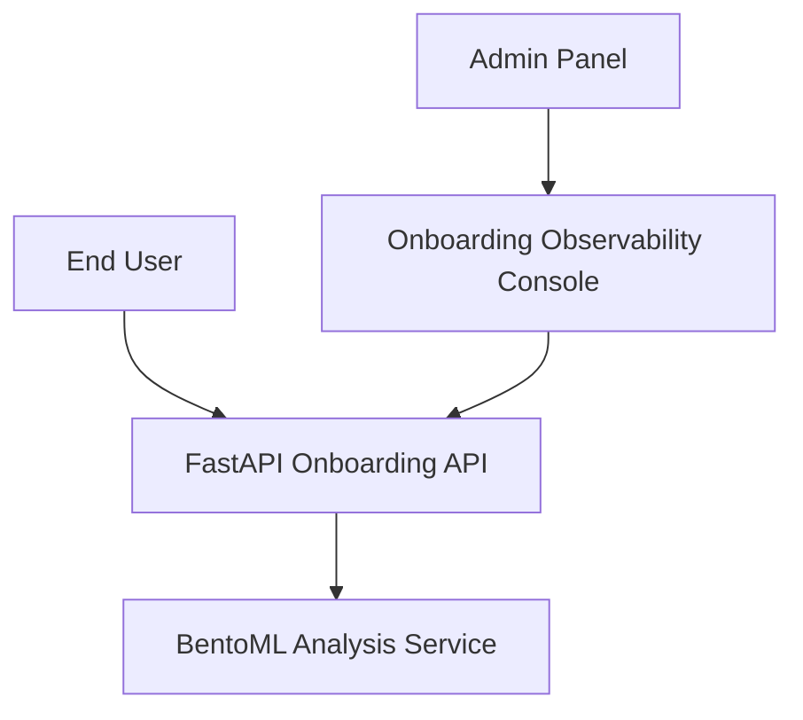

# Onboardly: Intelligent User Onboarding Platform


A professional-grade automated user onboarding and retention engine. Onboardly combines high-performance asynchronous web backends with specialized machine learning services (using BentoML) to track user progress, identify friction points in the onboarding lifecycle, and provide personalized coaching and intervention strategies.

## Table of Contents
- [Tech Stack & Architecture](#tech-stack--architecture)
- [Prerequisites](#prerequisites)
- [Installation & Local Setup](#installation--local-setup)
- [Usage & Running the App](#usage--running-the-app)
- [Testing](#testing)
- [Deployment](#deployment)
- [Contributing Guidelines](#contributing-guidelines)
- [License and Contact](#license-and-contact)

## Tech Stack & Architecture

### Core Technologies
- **App Backends**: `FastAPI` (User registration and API orchestration)
- **Frontend Dashboard**: `Streamlit` (Interactive admin observability)
- **Model Intelligence**: `BentoML` (Containerized onboarding prediction models)
- **Task Orchestration**: `Just` (Command automation)
- **Observability**: Unified JSON logging across all microservices.

### High-Level Architecture
Onboardly utilizes a modular distributed architecture:
- **`routers/`**: Decoupled API logic for onboarding steps, authentication, and status tracking.
- **`services/`**: Central business logic including intervention engines and model wrappers.
- **`bentoml/`**: Specialized folder for defining, training, and running the BentoML prediction services.
- **`website.py` / `benfront.py`**: Web-facing application layers for both user and admin interactions.



## Prerequisites
- **Python**: v3.12+
- **Tools**: `uv` package manager and `just` (command runner).
- **Network**: Port 8000 (API), 8501 (UI), and 3000 (BentoML) must be available.

## Installation & Local Setup

```bash
git clone https://github.com/DragoCodes/Onboardly.git
cd Onboardly
uv sync
```

### Dependency Management
If not using `uv`:
```bash
pip install -r requirements.txt
```

## Usage & Running the App

### Starting the Platform
Utilize the built-in `JustFile` command runner:
```bash
# Start all microservices concurrently
just start-app
```
Alternatively, manually start the backend:
```bash
uv run python website.py
```
And launch the administrative console:
```bash
uv run streamlit run frontend.py
```

## Testing
- **Linter**: `uv run ruff check .`
- **Load Testing**: `uv run locust -f locustfile.py` (Simulates high-concurrency onboarding flows)
- **Docs**: `mkdocs serve` (Launches the local technical documentation site).

## Deployment
Packaged with `BentoML` and defined with a `JustFile`, Onboardly is optimized for containerized deployments. We recommend deploying to AWS ECS or GCP GKE utilizing the included multi-service orchestration blueprints defined in our `mkdocs` documentation.

## Contributing Guidelines
1. Branch from `main`.
2. Follow **Trunk-based development**.
3. Use **Conventional Commits**: `feat: add progressive onboarding roadmap`.
4. Peer review required; code must pass all `ruff` linting rules.

## License and Contact
- **License**: MIT
- **Contact**: DragoCodes (https://github.com/DragoCodes)
